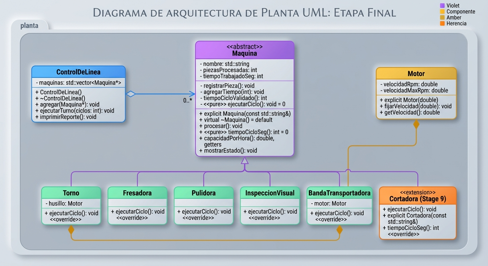

# Práctica Unidad IV: La evolución de una máquina

Programación Orientada a Objetos · Ingeniería Mecatrónica · Tercer semestre

Llena cada espacio conforme avances en las fases de [PRACTICA.md](PRACTICA.md).

## Fase 1. Entender el problema

**1.1 El problema con mis propias palabras**
El problema en si es que la maquina solo da las bases para el funcionamiento de cada  maquina torno,fresadora,  pulidora, pero esta tabien podria hacer  o mantener una herencia sobre que debe o puede aceptar una maquina lo cual se busca implementarse en  maquina para que en todas se pueda respetar .

**1.2 Reglas que siempre deben cumplirse en una máquina** (escribe al menos tres)

1. Debe estar  encendida____
2. Debe  esar fuera de mantenimiento____
3. Atributos  como tiempo deben ser siempre positivos mayor a 0____

**1.3 ¿Quién más usa la clase `Maquina`? ¿Qué podría salir mal si otro equipo crea una máquina nueva sin conocer tus reglas?**

Puede ser utilizada como  control de linea la cual incializa  todo el proceso  y podria salir mal que podrian modificar  atributos protegidos creado problemas en sintaxis o problemas  en valores, podria repetirse codigo , y incluso generar    malos   resultados a lo esperado 

## Fase 2. Diseñar la solución

**2.1 Diagrama inicial (Etapa 0)**

**2.2 Diagrama final (Etapa 9)**

**2.3 ¿Qué cambió entre los dos diagramas?**

| Elemento | Etapa 0 | Etapa 9 | Etapa que lo cambió |
| --- | --- | --- | --- |
| Visibilidad de los atributos de `Maquina` | ___si__ | __si___ | __1___ |
| `procesar()` | ___si__ | __si___ | _7____ |
| `tiempoCicloSeg()` | _si____ | __si___ | __5___ |
| Destructor de `Maquina` | ____no_ | __si___ | __2___ |
| ¿Se pueden crear objetos `Maquina`? | ____no_ | ___si__ | __5___ |
| Relación `ControlDeLinea` - `Maquina` | __no__ | __s___ | __3___ |
| Relación `Torno` - `Motor` | __no___ | ___si__ | _8____ |
| Relación `BandaTransportadora` - `Motor` | __no ___ | _si____ | __8___ |

## Fase 3. Implementar

**3.0 Etapa 0. Una máquina sin reglas**

a) ¿Qué imprime `ejecutarTurno()` para el torno y la fresadora? ¿Por qué no imprime "torneando" ni "fresando"?

Porque la función ejecutarTurno recibe las máquinas como Maquina en general, y como no le pusimos la palabra clave virtual al método procesar(), C++ "no se da cuenta" de qué tipo de máquina es en realidad (si es torno o fresadora).

b) ¿Por qué el torno acumula 65 s y no 135 s?

Por que al hacer el primer  ciclo se genera de manera correcta el ttiempo esperado de  torno  perro al hacer el segundo ciclo  hace el  tiempo trabajado seg  al  ejecutar ´rocesar por segunda vez 45+10+10=65

**3.1 Etapa 1. Invariantes y constructores explicit**

a) ¿Qué regla de la sección 1.2 rompió `torno.piezasProcesadas = -5;`?

El admitir  valores en los atributos negativos por lo que se buscaria es poner 0

b) ¿De dónde salió la máquina "Fantasma"? ¿Qué hizo el compilador sin que se lo pidieras?

std::string codigo = "Fantasma";
imprimirFicha(codigo);  en el main esta ubicado

c) ¿Qué tuviste que cambiar en `Torno` y `Fresadora` y por qué?
 se cambiaron accesos directos por   metodos que son protegidos, 

 Para respetar la encapsulación: En la clase base Maquina, los atributos pasaron a ser private para garantizar sus invariantes (evitar piezas negativas o tiempos inválidos).

**3.2 Etapa 2. Virtual y override**

a) La fresadora acumula 180 s, pero reporta 360 pzas/h. ¿Por qué un cálculo usó 60 s y el otro 10 s?

Por qué el tiempo acumulado usó 60 s: Al llamar a fresadora.procesar(), se ejecutó el método de la clase derivada Fresadora. Este método llamó a agregarTiempo(tiempoCicloSeg()) utilizando la versión del propio .cpp de Fresadora, que devuelve 60 segundos por ciclo  

Por qué la capacidad usó 10 s: La función capacidadPorHora() está definida en la clase base Maquina y es un método const (mostrarEstado() también lo es). Dentro de la clase Maquina.

b) ¿Tu compilador mostró alguna advertencia antes de usar `override`? ¿Qué mensaje dio después de agregar `override`?
al poner override  ejecutaba un codigo que imppedia que se usaran metodos distintos

**3.3 Etapa 3. La línea de producción**

a) ¿Por qué la línea procesó todo como "generico" si `procesar()` ya es virtual?

Porque el contenedor almacenaba objetos por valor (std::vector<Maquina>). Al agregar objetos de clases derivadas como Torno o Fresadora, se produjo el fenómeno de object slicing (rebanado de objetos): la parte derivada se descartó y solo se copió la rebanada correspondiente a la clase base

b) ¿Por qué el torno y la fresadora originales quedaron con 0 piezas?

Porque al pasarlos por valor a linea.agregar(), el vector guardó copias independientes de los objetos. Las modificaciones de las piezas y tiempos ocurrieron sobre las copias internas del vector durante el turno

c) La relación entre `ControlDeLinea` y `Maquina`, ¿es composición o agregación? ¿Por qué?

Es agregación. Las máquinas existen independientemente de la línea de producción (son creadas fuera o pasadas a la línea), y el control de línea únicamente mantiene

**3.4 Etapa 4. Destructores**

| Momento | Mensajes de destrucción que aparecieron |
| --- | --- |
| `delete temporal;` sin destructor virtual | __[Destruyendo Maquina]: Temporal (Únicamente invoca el destructor de la base; no llama al de la derivada).___ |
| `delete temporal;` con destructor virtual | __[Destruyendo Torno] seguido de [Destruyendo Maquina]: Temporal (Llama la cadena completa de destrucción).___ |
| Al terminar `main` (torno y fresadora) | [Destruyendo Fresadora], [Destruyendo Maquina], [Destruyendo Torno], [Destruyendo Maquina] (Destrucción automática por alcance en el stack)._____ |

a) ¿Qué advertencia mostró el compilador? ¿Por qué decimos que ya te estaba avisando del problema?

Mostró -Wdelete-non-virtual-dtor (deleting object of polymorphic class type which has non-virtual destructor). Avisaba que al hacer delete sobre un puntero a la clase base Maquina* cuya clase tiene métodos virtuales pero no un destructor virtual

b) ¿Por qué el torno de `main` sí se destruyó completo aunque el destructor no fuera virtual? ¿A qué máquina corresponde el primer "Destruyendo Maquina" después de "Fin de main"?

Porque las variables locales en el stack conocen su tipo exacto en tiempo de compilación (Torno), por lo que el compilador invoca directamente el destructor de Torno y luego el de Maquina por herencia sin requerir despacho dinámico.

**3.5 Etapa 5. La clase abstracta**

a) Copia los mensajes de error y explica con tus palabras qué dice cada uno.

src/main.cpp: error: cannot declare variable 'pulidora' to be of abstract type 'Pulidora'
note: because the following virtual functions are pure within 'Pulidora':
note: 'virtual void Maquina::procesar()'

Pulidora heredó de Maquina pero olvidó implementar el método virtual puro procesar(), lo que convierte automáticamente a Pulidora en una clase abstract

b) ¿Por qué es mejor este error de compilación que el comportamiento "generico" de antes?

src/main.cpp: error: cannot declare variable 'generica' to be of abstract type 'Maquina'
note: because the following virtual functions are pure within 'Maquina':
note: 'virtual void Maquina::procesar()'
note: 'virtual int Maquina::tiempoCicloSeg() const'

Intenta instanciar directamente la clase base Maquina, pero como contiene funciones virtuales puros (= 0), es una clase abstracta pura y C++ prohíbe crear objetos de ella.

**3.6 Etapa 6. El contrato que el compilador no ve**

a) ¿Qué partes del contrato violó `InspeccionVisual`?

Violó el contrato de tiempoCicloSeg() al devolver 0 (debe ser mayor que cero) y el contrato de procesar() al no invocar registrarPieza() ni agregarTiempo().

b) ¿Por qué el compilador no lo detectó?

Porque el compilador solo valida la sintaxis y las firmas (nombre del método, parámetros, tipo de retorno y cualificadores const/override), pero no comprende la semántica o lógica de negocio interna implementada en el cuerpo de la función.

c) ¿Qué pasaría si el próximo equipo tampoco lee el comentario del contrato?
El programa volvería a compilar sin advertencias, pero generaría reportes inconsistentes o errores silenciosos en producción

**3.7 Etapa 7. La base hace cumplir el contrato**

a) ¿Cómo puede una clase derivada sobrescribir un método que es privado en la base?

Porque en C++ la visibilidad (private/public) y el despacho dinámico (virtual) son totalmente independientes.

b) ¿Qué ocurre ahora con una máquina cuyo tiempo de ciclo es 0? Compáralo con la Etapa 6.

En la Etapa 6: El programa continuaba ejecutándose y producía reportes con capacidad inf (infinito).

En la Etapa 7: El método centralizado tiempoCicloValidado() intercepta el error en tiempo de ejecución y lanza inmediatamente una excepción std::logic_error, deteniendo el programa con un mensaje claro.

c) ¿Por qué la línea ignoró el "atajo" del torno, pero la llamada directa no? ¿Cómo corregiste el diseño
Llamada directa: Al invocar desde un objeto de tipo Torno, se ejecutó el método procesar() de Torno, el cual ocultó (hiding) al de la clase base.

Desde la línea: Al estar guardado como Maquina*, el compilador resolvió la llamada no virtual procesar() directamente en el tipo estático Maquina, ejecutando el contrato de la base.

Se eliminó la redefinición no virtual de procesar() en Torno, dejando que únicamente la base
**3.8 Etapa 8. Herencia mal usada**

a) Da al menos dos razones por las que `BandaTransportadora : public Motor` es un error de diseño.

Violación de la relación "Es-Un": Una banda transportadora no es un motor; la banda dejó de ser una Maquina, por lo que no puede ser agregada al ControlDeLinea

Exposición indeseada (Rompimiento de Encapsulamiento): Al heredar de forma pública, la banda expone métodos internos de Motor

b) La relación entre `BandaTransportadora` y `Motor`, ¿es composición o agregación? ¿Por qué?

Es composición. El Motor es un atributo privado de la BandaTransportadora; su ciclo de vida está completamente acoplado al de la banda (se crea y destruye junto con ella).

**3.9 Etapa 9. La librería y la prueba final**

a) Después de agregar la `Cortadora`, ¿qué archivos mostró `git status`? ¿Cuántos archivos de la librería tuviste que modificar?

Archivos en git status: Modificado src/main.cpp, y no rastreados include/Cortadora.h y src/Cortadora.cpp.

b) ¿Qué pasó al escribir `-lplanta` antes de `src/main.cpp`? ¿Por qué?

Ocurrieron errores de enlazado (undefined reference). Sucedió porque el enlazador (linker) procesa las dependencias de izquierda a derecha.

**3.10 Bitácora de dudas**

| # | Etapa | Duda | Cómo la resolví | Fuente |
| --- | --- | --- | --- | --- |
| 1 | __3___ | __¿Por qué std::vector<Maquina> perdía los datos de las derivadas?___ | __Entendiendo el concepto de object slicing al almacenar por valor.___ | _Guía teórica C++____ |
| 2 | _9____ | ___¿Por qué afectaba el orden de -lplanta en g++?__ | ___Estudiando el comportamiento del enlazador de GCC de izquierda a derecha.__ | ____Manual GCC / Linker Rules_ |
| 3 | _____ | _____ | _____ | _____ |

## Fase 4. Probar y mejorar

**4.1 Tabla de pruebas**

| # | Caso | Resultado esperado | Resultado obtenido | ¿Pasa? |
| --- | --- | --- | --- | --- |
| 1 | Máquina con nombre vacío | Excepción con mensaje claro | _____ | _____ |
| 2 | Reporte de una línea vacía | "La linea no tiene maquinas" | _____ | _____ |
| 3 | `agregar(nullptr)` | Devuelve `false` | _____ | _____ |
| 4 | Reporte antes de ejecutar el turno | 0 piezas, 0 s y capacidad calculada | _____ | _____ |
| 5 | Turno de 0 ciclos | Nada cambia | _____ | _____ |
| 6 | Torno con 3 ciclos | 3 piezas, 135 s, 80 pzas/h | _____ | _____ |
| 7 | Máquina con `tiempoCicloSeg()` igual a 0 | Excepción con mensaje claro | _____ | _____ |
| 8 | Máquina con `tiempoCicloSeg()` negativo | Excepción con mensaje claro | _____ | _____ |
| 9 | La misma máquina agregada dos veces | _____ | _____ | _____ |
todaas bien
**4.2 Bitácora de mejoras**

| # | Falla o mejora detectada | Qué cambié | Por qué |
| --- | --- | --- | --- |
| 1 | _____ | _____ | _____ |
| 2 | _____ | _____ | _____ |

Retos opcionales que intenté: _____

## Fase 5. Publicar en GitHub

**5.1 Enlace a mi fork**

https://github.com/FernandoRoman1709/ulsa_ime_3_poo_evolucion_maquina

## Cierre y reflexión

**6.1 Errores que ya no pueden ocurrir**

| Error | Etapa en que apareció | Restricción que lo impide ahora | ¿Quién lo detecta: el compilador o el programa? |
| --- | --- | --- | --- |
| Contadores con valores inválidos | 1 | _Atributos private e invariantes en setters/métodos de la base.____ | ____El programa_ |
| Máquina "fantasma" creada a escondidas | _1____ | Constructores con la palabra clave explicit._____ | __compilador___ |
| Método que no sobrescribe por un `const` | ___2__ | ___Uso de la palabra clave override.__ | __compilador___ |
| Máquinas copiadas y "rebanadas" | ____3_ | _Uso de colecciones con punteros (std::vector<Maquina*>) y clases abstractas.____ | _compilador___ |
| Destrucción incompleta | ___4__ | ___Destructor virtual ~Maquina() en la clase base.__ | __El compilador / El programa___ |
| Máquina sin `procesar()` propio | ___5__ | __Métodos virtuales puros (= 0) en la clase abstracta.___ | __El compilador / El programa___ |
| Tiempo de ciclo inválido | ___7__ | __Método tiempoCicloValidado() centralizado en la base.___ | ____l programa_ |
| Derivada que no registra sus piezas | _7____ | ___Patrón NVI: procesar() no es virtual y la base controla el ciclo__ | __l programa___ |

**6.2 ¿Cuál de los errores fue el más peligroso: el de compilación, la advertencia o el que compilaba sin problemas? ¿Por qué?**

fue el que compilaba sin problemas (fallo silencioso en tiempo de ejecución). Los errores de compilación y las advertencias detienen el desarrollo inmediatamente y señalan la línea exacta a corregir.

**6.3 ¿Qué aprendiste en esta práctica?**

El uso del patrón NVI (Non-Virtual Interface) para centralizar contratos y evitar que las clases derivadas salten las reglas de negocio.

La importancia de la destrucción polimórfica polimórfica con destructores virtuales para evitar fugas de memoria.

La diferencia crítica entre herencia ("Es-Un") y composición ("Tiene-Un"), eligiendo siempre la que preserve el encapsulamiento.

**6.4 ¿Qué cambiarías de tu proceso la próxima vez?**

Diseñar los contratos antes de escribir código: Definir primero las pre/postcondiciones e invariantes para no asumir comportamientos implícitos en las clases derivadas.

Prestar atención inmediata a los warnings: No ignorar advertencias del compilador, ya que suelen anticipar errores graves de ejecución como destrucciones incompletas o conversiones implícitas.